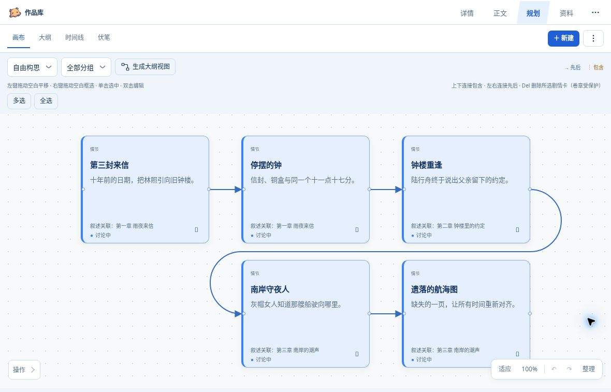
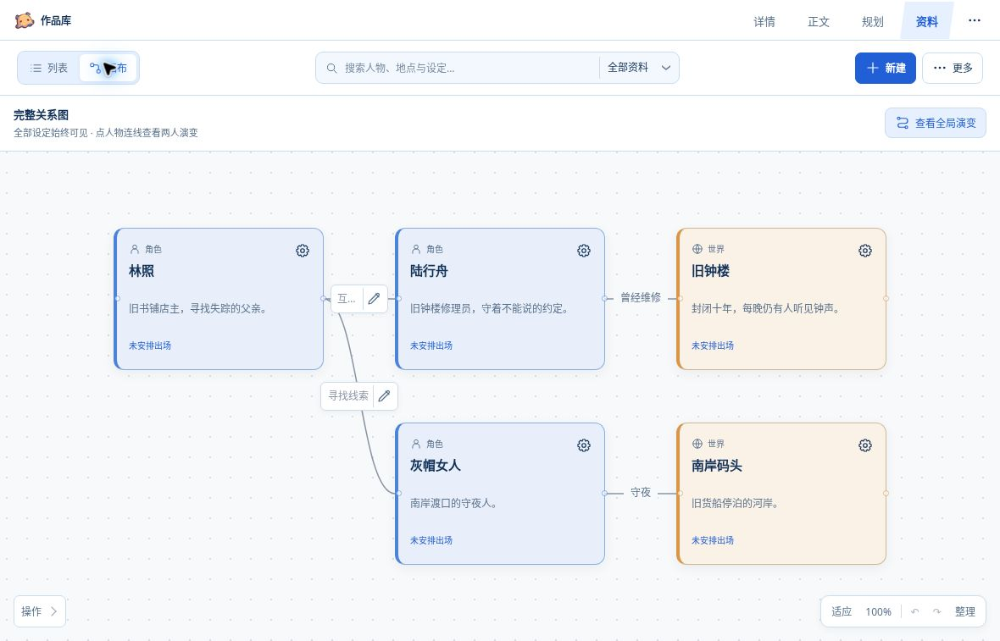
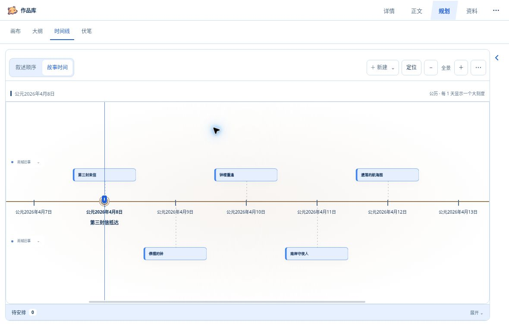
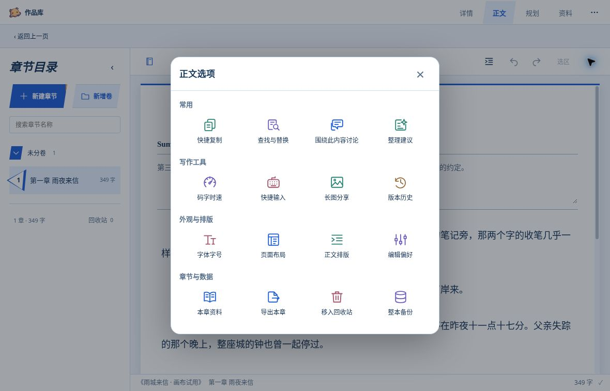

  
  

<h1 align="center">多端可选，多 Agent 协作。故事，始终是你的。</h1>

手机端 · 电脑 App 端 · 网页端 以 Codex 为主要创作入口，也支持 ChatGPT、DSH 与 Gemini 内容协作。

  <a href="https://github.com/CF-612/MoJi/releases">下载安装</a> ·
  <a href="docs/getting-started.md">开始使用</a> ·
  <a href="docs/cloud-agent-deployment.md">个人云端部署</a> ·
  <a href="docs/plugin-package.md">MCP 连接与插件更新</a>

**墨叽不是又一个只能粘贴正文的聊天框。** 它是一份你和 Agent 都能读写的小说工作台：正文、人物、世界设定、剧情卡与伏笔留在作品里，换设备、换聊天、换协作 Agent，也不必每次从头搬运设定。

在电脑 Codex 里推敲剧情，用手机 ChatGPT 接着讨论，再回到工作台亲手写下正文。连接同一个个人云端的客户端共用已保存的作品；你决定故事如何发展，Agent 按需读取资料、整理规划、协助修改。

> **Gemini 的边界：不支持工作台可视化，但支持内容读取与修改，可配合网页端使用。** 不同宿主的聊天历史不会自动合并；多 Agent 协作也不等同于多人实时共同编辑。并行修改同一章时，应处理版本冲突后再保存。

## 一份作品，贯穿整个创作过程

### 先把想法连起来，再把故事写下去

剧情卡不只是一张便签。同一套卡片可以在**自由画布、大纲和叙述时间线**中组织：用连线安排先后与包含关系，按卷章梳理结构，用页面和分组保留不同构思。

- **画布与大纲**：自由排布、自动生成大纲视图、框选与批量操作，规划不用挤成一长串笔记。
- **计划与正文分开**：剧情的讨论状态、关联章节及正文依据有迹可循，不把尚未采用的构思当成已发生的事实。
- **Agent 带着资料工作**：将正文或卡片交给当前聊天讨论，按需读取相关章节与设定，而不是反复复制整本小说。

### 人物、世界、伏笔，不再散落在各个对话里

角色与世界设定有自己的卡片、分组、关系和历史。人物关系可以随剧情演变；伏笔从一个点子开始，再随着埋设与回收补充依据。

正文中的一段话，可以成为人物、世界资料、剧情卡或伏笔的关联依据。**写作与整理在同一份作品里完成**，下一位协作 Agent 也能沿着这些资料继续工作。

### 读者知道的顺序，不一定是故事发生的顺序

**叙述时间线**按章节推进；**故事时间线**按实际发生时间安排。倒叙、插叙与跨越多年的往事，可以放回它们真正的位置，而不打乱正文顺序。

- 公历或自定义历法，明确设置故事起点、时间单位与刻度间隔。
- 自定义时间节点与轨道，按自己的习惯安排事件；轴上、轴下的含义由作者决定。
- 无事发生的漫长年代可折叠，人物关系演变跟随所查看的时间。
- 两种时间线共享操作方式与卡片资料，故事时间的位置独立维护。

### 正文清爽，工具随用随开

从日常码字到整理章节，不必为了一个小操作离开工作台。字号字体、页面布局、排版与编辑偏好各归其位；电脑和窄屏采用适合空间的布局，并支持明暗主题。

**快捷复制**支持标题＋正文、仅标题、仅正文和无空行正文；无空行复制保留段落换行，不改原稿。还可以查找替换、查看历史与差异、调整排版、使用快捷输入、统计码字时速、生成正文长图。

以上均为真实工作台截图，内容是专为展示准备的原创虚构示例，不含作者的私人小说。宿主外框、可用空间与具体入口会因客户端而异。

## 选你习惯的入口

| 你想怎么用 | 选择与存储方式 | 从这里开始 |
| --- | --- | --- |
| **电脑 Codex，主要创作入口** | 完整可视化插件连接自己的个人云端 | [部署与连接](docs/cloud-agent-deployment.md) → [创建 MCP 后原位更新 ZIP](docs/plugin-package.md) |
| **手机 ChatGPT / 网页 ChatGPT** | 使用个人云端，继续访问同一份作品；宿主需支持对应插件入口 | [跨端使用指南](docs/cloud-agent-deployment.md) |
| **DSH 原生插件** | **本地或个人云端可选**，保留 DSH 原生入口与会话协作 | [DSH 安装、更新与连接](docs/agent-installation.md) |
| **Gemini** | MCP 内容读取、修改；**没有可视化工作台**，可配合网页端使用 | [个人实例与 MCP 连接](docs/cloud-agent-deployment.md) |
| **Windows 独立版 / 本机浏览器** | 独立本地写作入口，不是 Codex 插件的本地模式 | [安装与开始使用](docs/getting-started.md) |

### 关于云端，有三件事先说清楚

1. **个人云端属于你。** 部署在你自己的 Cloudflare 账号，账号、用量和费用由你管理。墨叽不代付云端或模型费用。
2. **连接同一实例，才是同一份作品。** DSH 的本地库与云端库不会自动同步；迁移请使用完整备份导入，切换连接不会自动上传正文。
3. **更新源码、安装包与云端是三件事。** 下载新包不会自动升级个人云端；已有实例按[云端更新步骤](docs/cloud-agent-deployment.md)更新，保留原数据库和实例身份，不重复新建。

**官方流程：先创建自定义 MCP 并授权，再用 ZIP 在同一插件上“上传新版本”。** 生成器使用本人的实例地址和当前应用 ID，补齐墨叽原版图标、名称、简介和 GitHub 官网；不要把更新包另建为插件。**DSH `.tgz`、Windows ZIP、插件生成器 ZIP 与最终上传的个人插件 ZIP 不是同一种包。** 具体下载、生成与授权步骤见[插件包指南](docs/plugin-package.md)。密钥只在可信的授权页或隐藏输入中填写，不要发进聊天。

## 写作自由，也要保住原稿

- **自动保存与状态提示**：明确区分正在保存、已保存和失败；遇到版本冲突先核对双方修改，不静默覆盖。
- **版本历史与备份**：查看、比较、恢复章节历史；用完整备份保留正文及相关资料。重要操作前先备份，并验证副本能恢复。
- **草稿保护有边界**：本地持久化与恢复受宿主存储权限影响，不能把浏览器草稿当成永久备份；不要在未保存时清理应用数据。
- **按需启用模块**：不需要的板块可以关闭，界面保持轻量；隐藏模块不等于删除作品数据。
- **资料可以带进来**：支持角色卡、世界书及写作预设导入；保留内容，不承诺运行酒馆生态的全部规则。

[导入与导出](docs/import-export.md) · [角色卡与世界书](docs/tavern-import.md) · [写作预设](docs/presets.md) · [升级指南](docs/upgrade.md)

## 给开发者与反馈者

正式发行分支为 [`moji-release`](https://github.com/CF-612/MoJi/tree/moji-release)，开发分支为 [`codex/main`](https://github.com/CF-612/MoJi/tree/codex/main)。实际发行版本与可下载附件以 [Releases](https://github.com/CF-612/MoJi/releases) 为准，开发提交不等于所有端已经更新。

源码需要 **Node.js 24+**。本地启动、构建、测试和目录结构见[开发文档](docs/development.md)与[架构说明](docs/architecture.md)。各宿主的支持范围、安装权限和真实设备限制以相应安装指南为准，不以一次本地预览代替全端验收。

反馈时请提供**版本、客户端、复现步骤和预期结果**；截图、日志与备份先移除私人正文、账号信息及密钥。

## 来源与许可

墨叽基于 [mistnest/dsh-cuigengji-plugin](https://github.com/mistnest/dsh-cuigengji-plugin) 的催更姬继续开发，保留上游作者 **mistnest** 的版权声明与 [MIT 许可证](LICENSE)。来源基线与后续采用记录见 [UPSTREAM.md](integrations/chatgpt-workbench/UPSTREAM.md)。感谢上游提供的小说工作台基础。

MIT 许可适用于本仓库源码；小说、导入资料及第三方素材的权利归各自权利人，不因存放或导入墨叽而改变。
