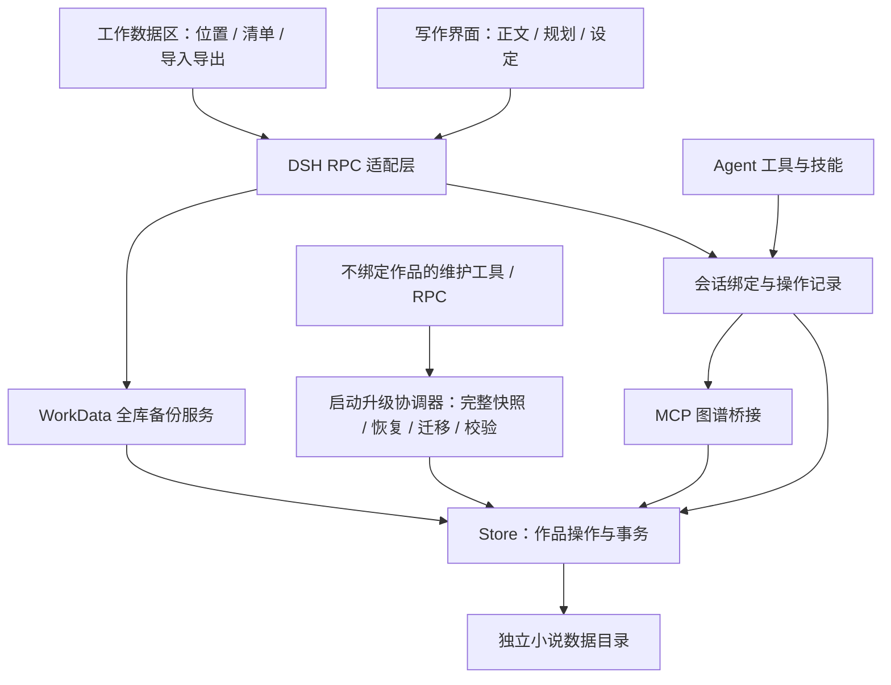

# 催更姬模块与工作数据



- `src/client/features`：正文、规划、设定、预设与工作数据界面，仅使用 RPC。
- `src/adapters/dsh`、`src/adapters/mcp`：宿主通信、技能注册与工具边界；全库导入导出仅供作者界面。
- `src/application/backup`：全库备份格式、SHA-256 校验、冲突预览、合并与导入前备份。
- `src/application/maintenance/upgrade.ts`：加载阶段统一备份、恢复、迁移、逻辑摘要比对和可用闸门；`upgrade-backup.ts` 管理根目录之外的完整原始快照。维护查询不要求绑定小说，迁移失败也不会挡住宿主 Agent 和插件管理。
- `src/application/bindings`、`src/application/queries`：会话绑定和按需接手信息；不会自动塞小说全文或全库资料。
- `src/domain/planning`、`src/domain/memory`、`src/domain/preset`：规划事务、资料分组与预设规则。
- `src/infrastructure/persistence`、`src/infrastructure/migrations`：跨进程锁与原子写入、旧格式转换。
- `project-store.ts` 按操作读取相关索引与目标正文；`project-layout.ts` 划分持久文件；`file-transaction.ts` 负责多文件提交、校验和中断恢复。业务 Store 与 Agent 工具仍使用原来的 action 和版本契约。
- `src/application/store.js`：仍编排作品、章节和图谱命令；进一步拆分时保持既有 action 与备份格式。旧路径保留兼容转发，TypeScript 迁移尚未覆盖全部 JS/JSX。

## 作者交互组件

`features/welcome` 提供欢迎页与作品入口，复用现有创建、导入和会话绑定操作；打开“作品首页”不解除当前绑定。`shared/WorkbenchHeader.tsx` 展示首页、正文、规划、设定、刷新、设置以及独立的关于入口，作品切换从首页完成，写作预设从设置进入。“关于催更姬”直接打开交流与支持信息，关闭后返回原页面并恢复按钮焦点。`shared/refresh.tsx` 只让各资源重新读取服务端索引，草稿、正文滚动位置和画布相机由各自组件继续持有。`shared/batch-management.tsx` 与 `batch-style.ts` 统一设定、规划的批量操作区和选择列表，移动范围限制为当前筛选可见的已选项，业务保存仍由对应功能模块负责。

章节目录行由 `DirectoryRow.tsx` 展示打开、字数和回收站操作，`useChapterReorder.ts` 单独管理拖拽、自动滚动与目录版本检查。正文标题用 `InlineTitle.tsx` 原位修改；删除前通过正文同步器等待已有保存，再保存后续输入，避免回收站吞掉本地草稿。恢复复用删除前版本，不改变正文版本契约。

作品首页的卡片主体与右侧回收按钮是并列按钮，分别负责打开作品与整本回收，避免嵌套按钮或点击穿透。“作品与备份”内的作品回收站提供恢复与永久删除。整本回收沿用 `archived`，新增可选的 `archivedAt`；旧归档作品也能恢复，不改变布局版本或业务 ID。

`application/novels/lifecycle.ts` 管理整本回收、恢复与永久删除。生命周期操作只开放给作者的 RPC，使用作品 revision 检查并发；会话策略检查这本作品的所有活动 Agent，运行中拒绝回收。回收会解除该作品的全部会话绑定，普通工具、旧编辑器和导入目标不能继续写入回收的作品；恢复不自动重新绑定会话。跨面板刷新仅传递变更通知，不传递正文。正文、章节历史、设定关系、规划页面、预设与导入原件在回收时保持原样。

永久删除必须从回收站发起，使用文件事务日志 v3：先核对目录路径和内部作品 ID，将完整目录暂存于事务目录，再提交作品索引、绑定和请求记录的变更，最后清理暂存目录。进程中断时通过原日志完成操作，其他作品与历史导出备份不受影响；旧 v1/v2 日志仍兼容。新增请求记录带作品 ID，以便清理该作品的重试缓存；无法确认归属的旧记录和审计日志不做猜测性清理。

规划的 `CanvasDraft.tsx` 管理原位新建和同请求重试，`DecorationInlineEditor.tsx` 管理批注草稿与冲突合并，`SceneCard.tsx` 统一卡片层级，`CanvasInspector.tsx` 提供不阻塞画布的详情侧栏。共享画布负责坐标、选择、移动和连线；成功写入后更新当前页面索引及批注，下一次操作使用已保存的版本。

缩放到总览时，`graph-style.ts` 将规划与设定统一为“状态或类型标识＋标题”的缩略卡片；隐藏摘要与章节引用，重新分配留白。缩略展示沿用原卡片的世界坐标尺寸和连线锚点，类型、标题、选中边框及连接点随缩放保持可辨识。

## 独立数据目录

配置优先级：插件 `dataRoot` > `CUIGENGJI_DATA_ROOT` > 系统默认目录。小说数据应存放在仓库之外，与源码、DSH Home 和 Electron 浏览器数据分开；公开仓库不提供个人作品或运行数据。工作数据页显示服务实际使用的绝对路径，迁移应核对作品名称清单，不能只按文件是否复制成功判断。

存储布局版本 4 按书名目录隔离，章节、设定和规划页使用“可读名称 + 稳定短 ID”作为文件名。`library.json` 保存作品 ID 与目录名的映射，各模块索引保存对象 ID 与文件名的映射；工具、正文引用和备份仍使用完整业务 ID：

```text
dataRoot/
  library.json                         作品索引、ID → 目录名与存储格式版本
  novels/<书名>/
    project.json                       作品信息、卷目录与模块清单
    chapters/index.json                目录、字数及版本引用索引
    chapters/第1章 雨夜来信--a1b2c3d4.json 当前正文与元信息（含软删除章节）
    planning/index.json                页面、事件、关系及变更索引
    planning/主线--main.json             默认画布
    planning/码头决战--e5f6a7b8.json       本页事件、箭头、框与便签
    planning/legacy.json                旧规划原文（如存在）
    settings/index.json                设定索引
    settings/entries/角色-林序--c9d0e1f2.json 人物全文
    settings/entries/世界-雾港--a3b4c5d6.json 世界设定全文
    settings/groups.json               设定分组（如存在）
    settings/relations.json            设定关系
    preset.json                        作者预设及导入原文（如存在）
    imports/originals.json              酒馆原始资料（如存在）
    history/chapters/<章节ID>.json       正文历史版本
    history/planning/<变更ID>.json       完整规划变更与撤销快照
    history/planning-legacy.json        画布转换前的旧规划原文（如存在）
  runtime/bindings.json                 会话绑定
  runtime/upgrade.json                  实际加载版本、升级阶段和完整性结果
  runtime/requests/<请求哈希>.json      防止重复操作的结果记录
  audit/                               操作日志
  backups/                             迁移及导入前快照
```

索引不保存全文；普通查询只读取目标作品的所需索引，正文读取不带历史，规划详情只读取对应画布页。保存只提交变化的文件。涉及正文、设定失效标记、画布结构与请求结果的修改，使用同一个跨进程锁及持久事务日志，恢复完成后才允许下一次操作读取。事务暂存内容全部通过校验后才开始覆盖目标，中断后的操作会先完成恢复。

0.4.0 插件加载阶段先在数据根旁的 `.cuigengji-upgrade-backups` 创建完整原始快照，再恢复事务、验证整个旧数据并迁移；存储层仍保留 `backups/before-storage-*` 等逻辑检查点。迁移前后比较完整逻辑摘要，保留对象 ID、revision、正文版本、回收站、页面、批注、导入原文、绑定和请求记录；格式不合法会报错并保留原文件。迁移后的 `store.json` 是旧快照，新版以 `library.json` 与作品目录为准。升级完成后正常查询继续按需读取，不把维护记录放进写作上下文。

已有布局版本 2 的 ID 目录会在完整验证后迁移到书名目录；迁移前将完整逻辑数据、原索引与目录对应表保存到 `backups/before-project-names-*`。书名中的 Windows 非法字符替换为下划线，保留原始显示书名；重名（含仅大小写不同）或已有同名文件使用“书名（2）”等后缀，保留已有目录编号。书名长度限制仅影响文件夹名。在插件内重命名作品会同步迁移目录，大小写或非法字符替换后等价的改名保留当前目录。

已有布局版本 3 会先验证完整逻辑数据，保存 `backups/before-readable-files-*` 快照，再通过事务生成新文件、更新索引并清理原先托管的 ID 文件。短 ID 取完整业务 ID 的 SHA-256 前 8 位，仅用于文件命名，不替代任何引用。Windows 非法字符、保留名、长标题、大小写和同名冲突均处理；若目标位置有作者自存文件，会增加“（2）”等后缀，保留原文件。历史、请求和事务文件继续使用内部 ID。

在插件内修改章节标题、设定名称或规划页名称会同步更新文件名；恢复旧章节标题也会更新。目录拖拽顺序不写进文件名，避免一次排序引起大量改名。改名只改变物理存储映射，正文、历史、角色来源、规划连线及正文版本引用保持完整；规划页改名会先读取该页完整内容。

目录移动、文件改名、元信息、索引和请求结果共用可恢复事务；中断后先恢复，再允许读写。整个目录移动会保留未加载的正文、历史和作者额外存放的文件。切换存储格式前关闭旧版宿主；旧版程序不接受布局版本 4。插件维护索引与文件名；给作者交换内容继续使用一键导入/导出。

## 备份契约

作者的单本、局部内容和全库操作统一进入“导入 / 导出”。全库使用独立版本化格式 `cuigengji-workspace`，保存整个 Store（含归档作品、删除章节及历史、规划变更、原始预设、绑定和请求记录），并附带操作日志、旧规划迁移备份及校验码。

磁盘布局版本与导出版本独立：现有 `cuigengji` 单本备份和 `cuigengji-workspace` 全库备份仍可导入。新范围选择使用 `cuigengji-package` 数据包；全库保持原有格式，旧单本 RPC 也保持原逻辑格式。整库备份会完整重建并验证数据，不从索引代替正文，不递归打包本机旧快照或事务暂存文件。

导入前预览；确认时在同一 Store 锁内重新校验冲突。相同作品跳过，不同内容的同 ID 作品、不同绑定或分叉日志拒绝导入。当前工作数据先存入 `backups/before-import-*`，再合并；源备份不修改。相同日志的前缀版本保留较长一份。导入前备份是本机回滚快照，不递归打包进后续导出，避免备份无限膨胀。

这是小说工作数据备份，不是 DSH 整机备份：聊天记录、附件、凭据由 DSH 管理，浏览器未保存草稿需先保存。备份预览会明确提示边界。恢复会话绑定依赖相同的 DSH 会话 ID；只迁移小说时仍可在新会话手动选择作品。

## 后续解耦边界

后续可将 `application/store.js` 的 Novel/Chapter 与 Graph 命令继续分离，逐步为剩余 JS/JSX 增加类型契约。每一步都应以旧数据、版本冲突和完整备份的回归测试保证兼容；Agent 始终是写作助手，正文优先，资料按需读取。


## 统一导入与导出

文件识别、范围和关联收集、复用时的 ID 重映射、预览与原子保存分别位于 `src/application/transfer` 的独立 TypeScript 文件，共享契约位于 `src/contracts/transfer.ts`。页面位于 `src/client/features/transfer`，其他模块只传递预选范围。详细格式、恢复与复用行为见[导入与导出](import-export.md)。
